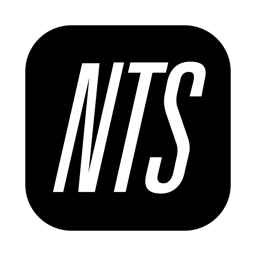
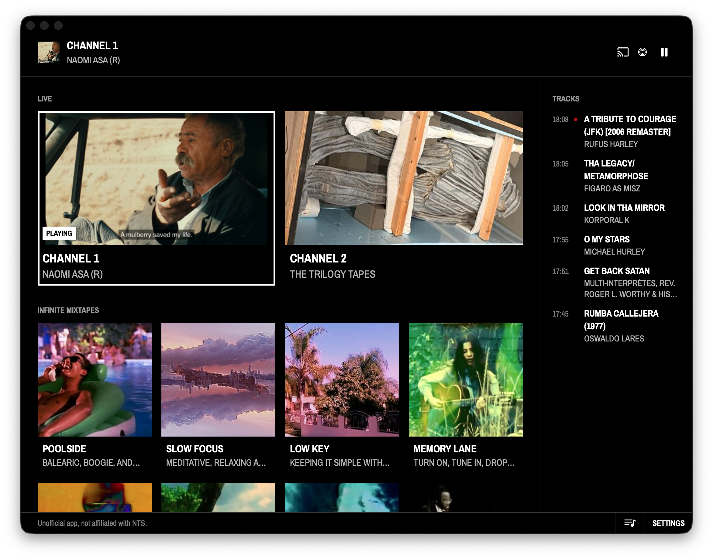
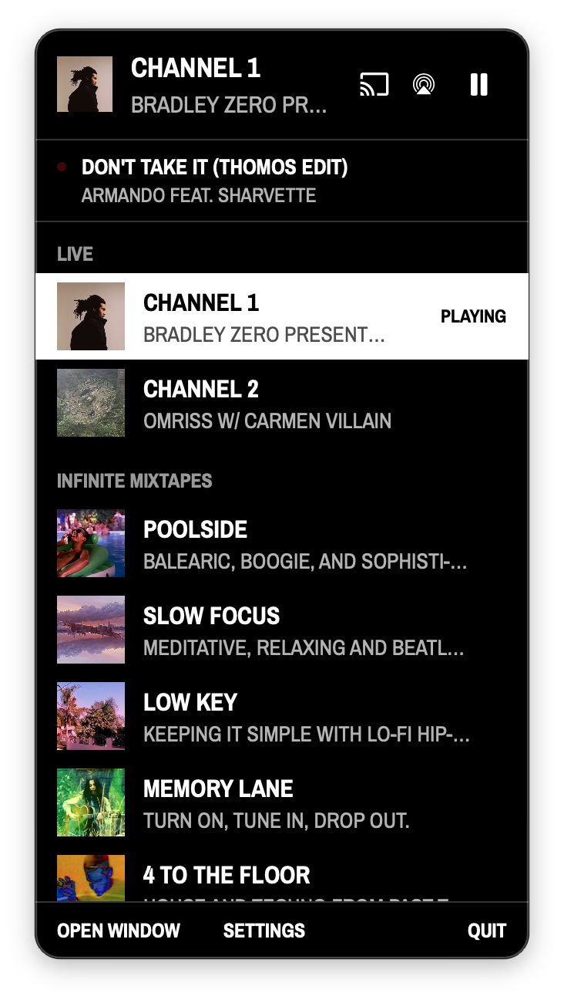

<p align="center">
  
</p>
<h1 align="center">NTS for Mac</h1>
<p align="center">An unofficial NTS Radio player for the macOS menu bar, with Google Cast and AirPlay.</p>
<p align="center">
  <a href="LICENSE"></a>
  
  
</p>

<p align="center">
  <a href="https://github.com/sanderjn/nts-mac/releases/latest/download/NTS.dmg"><b>Download NTS for Mac</b></a>
</p>

Listen to [NTS](https://www.nts.live) from the menu bar: both live channels and the Infinite Mixtapes, on your Mac, a Chromecast, a Google speaker or an AirPlay device. NTS Supporters also see which track is playing. Native Swift and SwiftUI, no Electron, no tracking, and no account needed to listen.

This is a fan project. It is not made by, affiliated with or endorsed by NTS.



## Features

- **Live channels 1 and 2** with the show that is on now, plus all **Infinite Mixtapes**.
- **Menu bar first:** pick a station from the popover, open the full window when you want one.
- **Google Cast** to a Chromecast, Google TV or Nest speaker, with a volume slider for the device.
- **AirPlay** to any AirPlay speaker or TV.
- **Media keys and Control Center** show and control what is playing.
- **Tracks for NTS Supporters:** the track that is playing and the ones before it, see below.
- **Settings** to launch at login and to hide the Cast or AirPlay button.

## Tracks



NTS recognises the tracks on its streams and shows them to its [Supporters](https://www.nts.live/supporters). Sign in with your NTS account under **Settings → NTS account** and the app shows them too:

- **In the window:** the last ten tracks next to the stations, with a red dot on the one that is playing. The button at the bottom hides the list.
- **In the menu bar:** the playing track under the show.
- **In Control Center:** the playing track, next to the show.
- **Click a track** to copy its artist and title.
- **Track notifications:** a notification when a new track starts. Off until you turn it on in the settings.

Talk and unrecognised music show no track. Without an account none of this shows, and the app is a player and nothing more.

Your password goes straight to the sign-in NTS itself uses and is not saved. What keeps you signed in is a token in your macOS keychain, which **Sign out** removes. After you update the app, macOS may ask once if NTS may use that keychain item.

<br clear="right">

## Install

1. [Download NTS.dmg](https://github.com/sanderjn/nts-mac/releases/latest/download/NTS.dmg) and open it.
2. Drag **NTS** onto the **Applications** folder.
3. Open NTS from Applications.

The app is not signed with a paid Apple developer certificate, so macOS blocks it the first time. You only have to do this once:

1. macOS says it could not verify NTS. Click **Done**.
2. Open **System Settings → Privacy & Security** and scroll down to **Security**.
3. Click **Open Anyway** next to the message about NTS, and confirm.

On macOS 14 you can instead right-click the app and choose **Open**.

The first time you use Cast, macOS asks if NTS may find devices on your local network. Allow it, or turn Google Cast off in the settings if you do not use it.

There is no automatic update. To update, download the new version and replace the old one.

Built for macOS 14 and later, Apple Silicon and Intel.

## Settings

Open them from the menu bar popover, from the bottom of the window, or with <kbd>⌘</kbd><kbd>,</kbd> while the window is open.

## Building from source

Needs a Swift 6 toolchain. The Command Line Tools are enough, Xcode is not required.

```sh
git clone https://github.com/sanderjn/nts-mac.git
cd nts-mac
bash scripts/build-app.sh
```

That assembles `build/NTS.app`. It is ad-hoc signed, which is enough to run it on the Mac that built it.

`scripts/release.sh 1.0.0` builds a universal app and packs it into `build/NTS.dmg`.

### Checks

`swift test` does nothing without a full Xcode install, so the checks are a plain executable:

```sh
swift run Check
```

`swift run CastProbe` lists the Cast devices on your network, which helps when a device does not show up in the app.

## How casting works

There is no Google Cast SDK for macOS, so the app speaks the Cast protocol itself: it finds devices over Bonjour, opens a TLS connection and asks Google's Default Media Receiver to play the NTS stream. The code is in `Sources/NTSCore/Cast*.swift` and has no dependencies.

## Also

[NTS for Android TV](https://github.com/sanderjn/nts-tv): the same stations on a Google TV or Android TV, picked with the remote.

## License

MIT, see [LICENSE](LICENSE). The bundled typeface is [Archivo Narrow](https://github.com/Omnibus-Type/ArchivoNarrow), under the [SIL Open Font License](Resources/ArchivoNarrow-OFL.txt).

NTS, the NTS logo, the tracklist icon and everything you hear and see from the stations belong to NTS. The logo and the icon are used here only to show what the app plays, and are not covered by the MIT license. If you like NTS, [support them](https://www.nts.live/supporters).
